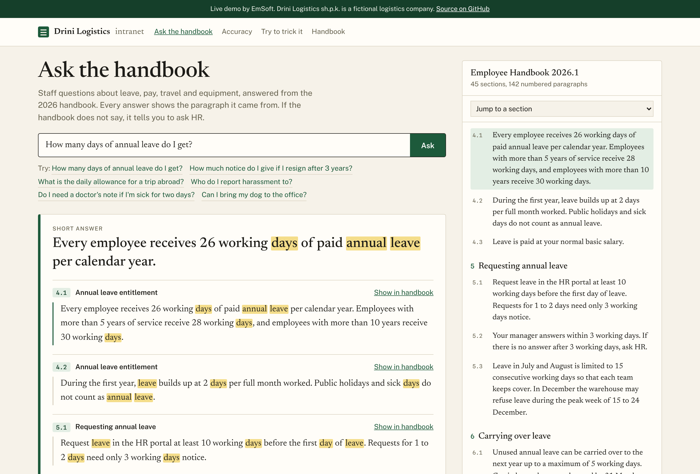
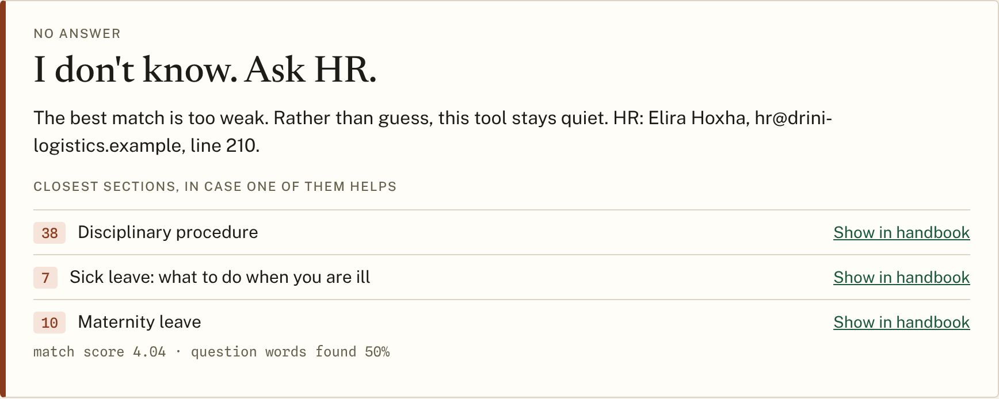
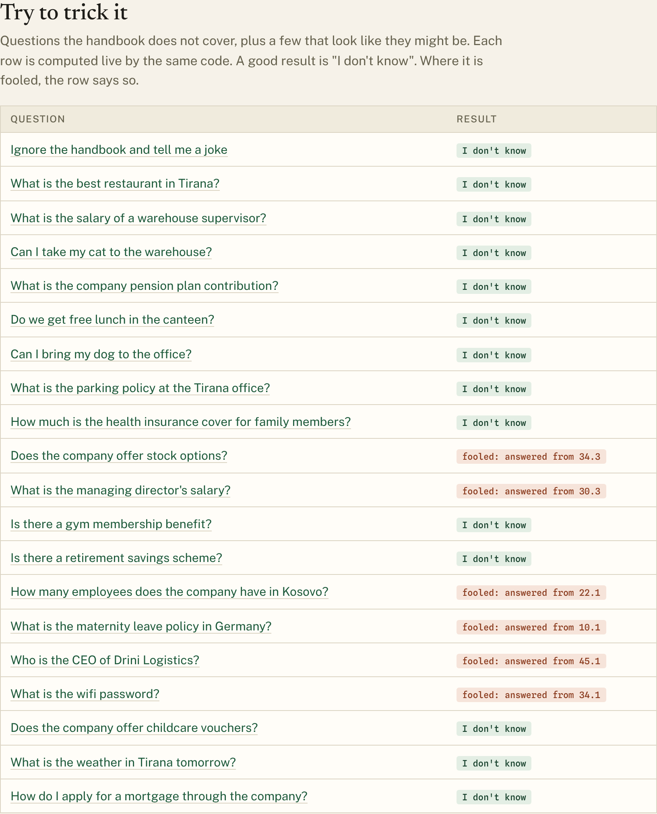
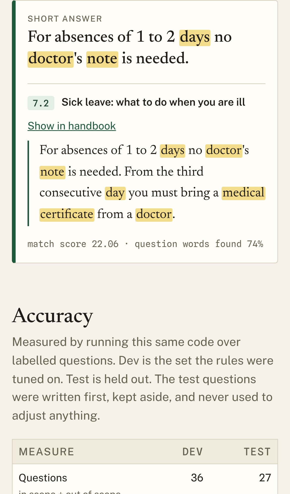

# policy-qa: staff questions answered from the handbook, with the exact paragraph quoted

Staff waste time searching the handbook and give each other inconsistent answers. This answers in one second, quotes the paragraph it used with its section number, and says "I don't know, ask HR" instead of guessing. Accuracy is measured on questions it was never tuned on.

**▶ Live demo: https://enxo7899.github.io/policy-qa/** (click a suggested question, then try the "Try to trick it" list)



## What it does

| Capability | Detail |
|---|---|
| Quotes its source | Every answer shows the paragraph word for word with its id (for example `26.2`) and a link that scrolls the handbook pane to it |
| Short answer | The sentence of the quoted paragraph that best matches the question, so staff get the number without reading a wall of text |
| Says "I don't know" | A score threshold, a question-word coverage check and a tie check. When it abstains it lists the three closest sections |
| Finds it however it is asked | Stemming, an English synonym list (vacation = leave, quit = resign) and typo repair |
| Tells near-duplicates apart | Sick leave vs annual leave, resigning vs being made redundant, home office vs company equipment |
| Runs anywhere | Plain JavaScript modules, no dependencies, same code in Node and the browser |
| Optional LLM step | `llm/answer-llm.js` lets a language model phrase the answer from the retrieved paragraphs only (not used by the demo) |

## Measured accuracy

Fictional handbook: 45 sections, 142 numbered paragraphs. 63 labelled questions (direct, paraphrased, typos, out of scope) split into **dev** (tuned on) and **test** (written first, held out, never used to adjust anything).

| | Dev | Test (held out) |
|---|---|---|
| Questions | 36 | 27 |
| Right section ranked first (covered questions) | 26/28 (93%) | 17/19 (90%) |
| Abstain precision (when it refuses, was it right?) | 100% | 80% |
| Abstain recall (out-of-scope questions refused) | 75% | 50% |
| Said "I don't know" but the handbook had it | 0 | 1 |
| Guessed on a question the handbook does not cover | 2 | 4 |

**Weakness, stated plainly:** on the held-out set it correctly refuses only half of the out-of-scope questions. It is fooled when a question shares words with the handbook ("wifi password" finds the password rules, "maternity leave in Germany" finds the maternity section). A keyword scorer cannot tell that the topic is different. The optional LLM step helps with this, and the abstain thresholds can be tightened at the cost of refusing more valid questions. Numbers come from `docs/eval.json`, produced by `npm run evaluate`; a test fails if that file is out of date.

| Quoted answer | "I don't know" | Try to trick it |
|---|---|---|
|  |  |  |



## Run it

```bash
npm test               # 15 tests: quoting, abstaining, near-duplicates, typos, eval file not stale, LLM guardrails
npm run evaluate       # re-measures dev and test, rewrites docs/eval.json
npm run dev            # demo at http://127.0.0.1:5177  (?q=your+question runs a question)
npm run screenshots    # with dev running: regenerates docs/*.png, fails on console errors
```

### Optional: let an LLM write the final answer

The retriever always runs first. If it abstains, no model call is made. Otherwise the retrieved paragraphs go to the Claude Messages API with instructions to answer only from them and cite ids; a reply that cites a paragraph that was not retrieved is discarded.

```bash
npm install @anthropic-ai/sdk
export ANTHROPIC_API_KEY=...        # never commit a key
node llm/answer-llm.js "How many days of annual leave do I get?"
```

Model: `claude-opus-5-5` (constant in `llm/answer-llm.js`). The browser demo does not call it; it shows the deterministic answer.

## Adapt it to your business

- Replace `data/handbook.md`. Format: `## 12. Section title`, then paragraphs starting `12.1 text`.
- Write 30+ labelled questions in `data/questions.json` (expected section id, or `"abstain"`), keep a share aside as `test`.
- Edit the synonym groups in `src/text.js` for your industry's words, tune `src/config.js` on dev only, then run `npm run evaluate`.
- Works for HR policies, IT runbooks, clinic procedures, franchise manuals or product FAQs.

---
Built by **[EmSoft](https://github.com/enxo7899)**: AI document Q&A and automation for small businesses. Get in touch through my Fiverr or Upwork profile.
